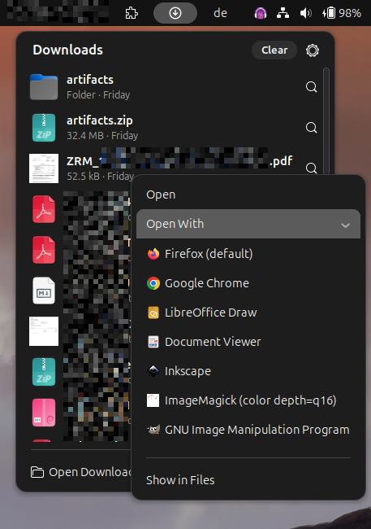
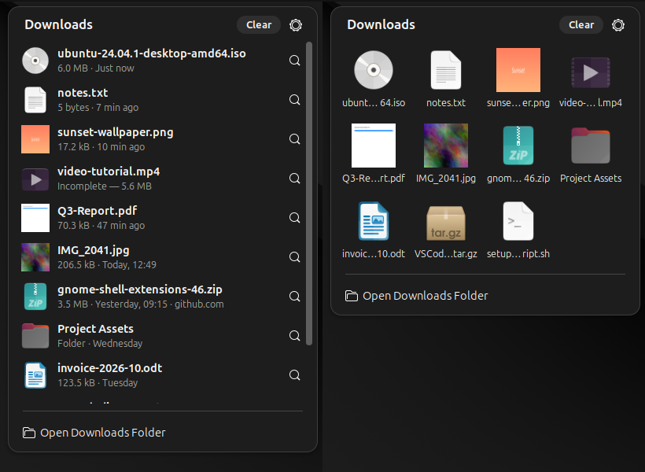
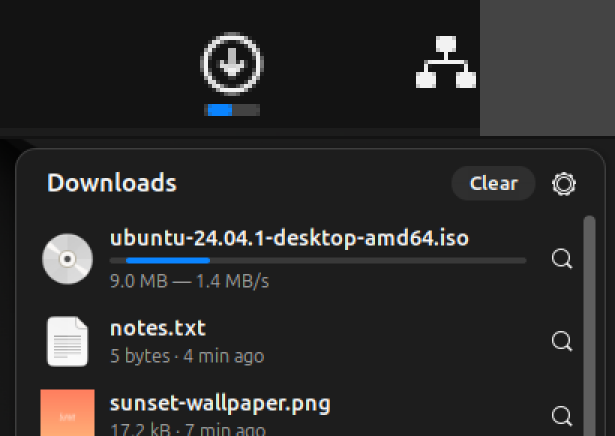

# Downloads Stack

A macOS-style Downloads menu for the GNOME Shell top panel.

Click the download icon in the panel to see your latest downloads, newest first,
the way the Safari downloads popover and the Dock's Downloads stack work on macOS.







## Features

- **List or grid view.** Each entry shows a thumbnail, the file name, size, when it
  arrived and the site it came from (when the browser recorded it).
- **Real previews.** Images, PDFs, videos and anything else a GNOME thumbnailer can
  handle get a preview. Missing thumbnails are created in the background, the same
  way Files does it.
- **Downloads in progress.** `.part`, `.crdownload`, `.download`, `.partial` and
  `.opdownload` files appear at the top with an animated progress bar and the current
  speed. A small progress bar also appears under the panel icon. Downloads that stop
  for 30 seconds are shown as "Incomplete" and sorted with the others.
- **Bounces when a download finishes**, and a blue dot marks downloads you haven't
  seen yet.
- **Click** opens the file. The magnifier button shows it in Files.
- **Right-click** (or the Menu key) opens a context menu with **Open**, **Open With**
  (every app that handles that file type, default first) and **Show in Files**.
  Arrow keys, Enter and Escape work too.
- **Clear** hides the current downloads from the list, like Safari. It never deletes
  files. You can bring them back in Settings → History.
- **"Open Downloads Folder"** at the bottom, like "Open in Finder".

## Install

```sh
make install          # pack + install into ~/.local/share/gnome-shell/extensions
```

Then reload GNOME Shell:

- **X11:** press `Alt+F2`, type `r`, press Enter
- **Wayland:** log out and back in

and enable the extension:

```sh
make enable
```

For development, `make link` symlinks this folder into the extensions directory
instead of copying it, so after editing you only need to reload the shell.

## Try it without touching your session

```sh
make nested
```

This opens a nested GNOME Shell in a window with the extension already enabled.
It uses throwaway config and data folders, so your real settings stay as they are,
and it shows your real Downloads folder.

## Settings

Open them with the gear button in the menu, or with `make prefs`:

| Setting | Default |
| --- | --- |
| Downloads folder | XDG Downloads directory |
| View as | List (or Grid) |
| Sort by | Date Added (or Date Modified) |
| Number of downloads | 12 |
| Generate previews | on |
| Show folders / hidden files | on / off |
| Panel position and order | right, first |
| Bounce when a download finishes | on |
| Dot for new downloads | on |

"Date added" uses the file's change time (ctime). On Linux that time is set when a
finished download is renamed or moved into the folder, which makes it the closest
match to macOS's "Date Added".

## Files

| File | Purpose |
| --- | --- |
| `extension.js` | Panel button, popover UI, list and grid rows, animations |
| `downloadsMonitor.js` | Watches the folder, sorts and filters entries, tracks downloads in progress |
| `thumbnailer.js` | Creates missing previews with GNOME's thumbnail factory |
| `prefs.js` | Settings window (libadwaita) |
| `stylesheet.css` | Styling |
| `schemas/` | GSettings schema |
| `icons/downloads-symbolic.svg` | Panel icon |

Tested on GNOME Shell 46 (Ubuntu 24.04). `metadata.json` also lists 45, 47 and 48,
and the code handles the `St.BoxLayout` orientation change in 48, but those versions
have not been tested.
